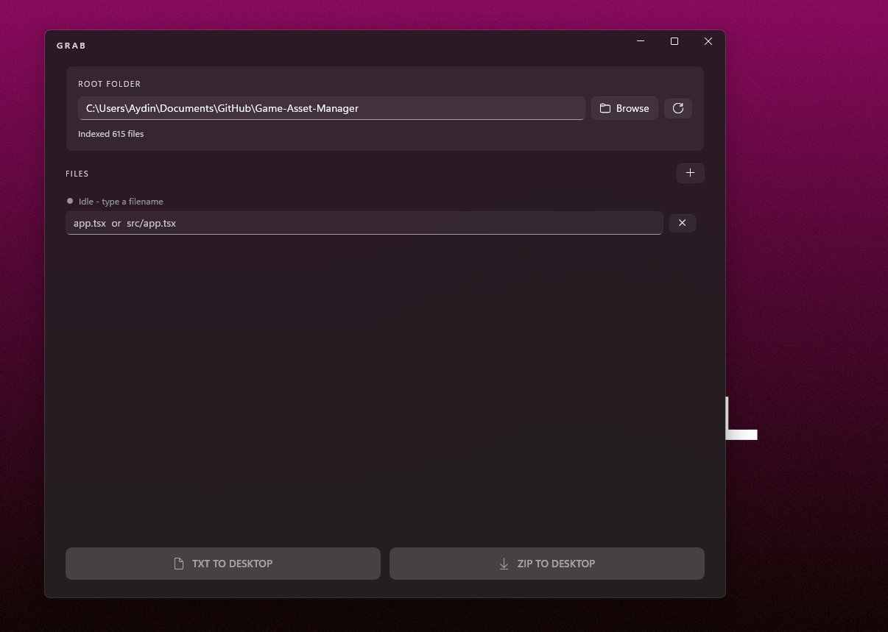

# GRAB

**Quickly grab the files you actually need out of any project folder - verified live, exported in one click.**

GRAB is a native Windows 11 desktop utility for developers. Point it at a project folder, type the filenames you care about, and GRAB verifies each one in real time against an in-memory index of the folder. When you're done, export everything to the Desktop as a single **TXT dump** or a **ZIP** that preserves the original folder structure.

Built for the "I just need to send these 12 files to an AI / a reviewer / my notes" workflow.



---

## Why

Collecting specific source files out of a project is annoyingly manual. You copy a path, open it, copy the content, paste it somewhere, repeat. If you get one filename wrong, nobody tells you - you just ship an empty section.

GRAB fixes that:

- **Type it.** Enter `app.tsx` or `src/app.tsx` or `lib\utils\helpers.ts`.
- **See it.** A green / red / grey dot tells you instantly if GRAB found it, and where.
- **Export it.** One click writes a single UTF-8 file (or ZIP) to your Desktop.

---

## Features

### Root folder + file rows
- Native WinUI 3 `FolderPicker` for choosing the root folder.
- The last-used root folder is remembered in `%AppData%\Grab\settings.json`.
- Dynamic list of file input rows - add with `+`, remove with `✕`.
- Each row accepts either a **bare filename** (`app.tsx`) or a **relative path** (`src/app.tsx`). Ambiguous names are resolved to the shortest matching path, and the UI tells you how many other matches exist.

### Live availability checker (the important part)
- **2-second debounce** on every keystroke - GRAB never checks while you're typing. A `DispatcherQueueTimer` restarts the countdown on every key press and only fires once you've actually stopped.
- **Async file indexer** built on `Task.Run` - the UI thread never blocks, no matter how big the project.
- **Status per row:**
  - 🟢 **Found** - shows the resolved relative path
  - 🔴 **Not found**
  - ⚪ **Idle / empty / waiting**
- The index is rebuilt automatically when the root folder changes (also 2-second debounced), and there's a manual refresh button.

### What gets skipped
To keep the index fast and the exports useful, GRAB ignores:

- **Folders:** `node_modules`, `.git`, `dist`, `build`, `bin`, `obj`
- **Binary files:** images, archives, executables / compiled artifacts, media, Office documents, PDFs, fonts, databases (see `FileIndex.cs` for the full list)

Everything else - source code, configs, markdown, JSON, YAML, plain text - gets indexed.

### Exports
Both formats write to your **Desktop** with a timestamped filename (`Grab_YYYYMMDD_HHMMSS.txt` / `.zip`).

- **TXT TO DESKTOP** - a single UTF-8 file. Each matched file is written as:
  ```
  relative\path:

  [file content]


  ```
  Perfect for pasting into an LLM, a code review, or a notes app.
- **ZIP TO DESKTOP** - a standard ZIP that preserves the original folder structure.

Both are written as **UTF-8 without BOM**, so emojis, accented characters, CJK, and other non-ASCII content survive round-tripping without corruption. After a successful export, the file rows are cleared back to a single empty row - the root folder and index stay loaded.

### Design
- **WinUI 3**, not WPF.
- **Mica backdrop** (`MicaBackdrop`) with dark mode by default.
- **Extended title bar** (`ExtendsContentIntoTitleBar = true`) with native Windows 11 caption buttons overlaid.
- Fluent design throughout - rounded corners, subtle borders, `CardBackgroundFillColorDefaultBrush`.
- **60fps Composition animations**: a fade + slide intro on launch, and a spring-based scale "pop" on button hover.
- `AddDeleteThemeTransition` and `ReorderThemeTransition` on the file list.

### Reliability
- All unhandled exceptions are caught at three levels (`App.UnhandledException`, `AppDomain.UnhandledException`, `TaskScheduler.UnobservedTaskException`) and logged to `%AppData%\Grab\Logs\grab-YYYYMMDD.log`.
- File locks, permission errors, deleted folders, and unreadable files are handled gracefully - a failed file is skipped with a note in the UI, the export itself never crashes.
- Exports use `FileShare.ReadWrite | FileShare.Delete` on reads so files being edited elsewhere don't break the export.
- Partial exports that produced nothing get the half-written file cleaned up.

---

## Quick start

### Option A - Build from source (one script, no manual setup)

You need the **.NET 8 SDK** installed ([download](https://dotnet.microsoft.com/download/dotnet/8.0)). Nothing else - the build script fetches the Windows App SDK NuGet packages and produces a **self-contained single-file `Grab.exe`**.

```powershell
powershell -ExecutionPolicy Bypass -File .\Build-Grab.ps1
```

The script will:
1. Generate all source files into `Grab-Src\`
2. Restore, build, and publish a self-contained `Grab.exe`
3. Drop it in `Grab-Output\`
4. Launch it

The first run takes a few minutes (NuGet download + full publish). Subsequent runs are much faster.

### Option B - Pre-built binary

Grab `Grab.exe` from the [Releases](../../releases) page. It's **fully self-contained** - no .NET runtime install needed on the target machine.

---

## How to use

1. Click **Browse** (or paste a path) to select your project's root folder. GRAB scans it in the background.
2. Wait for `Indexed N files` to appear.
3. Type a filename in the first row (e.g. `app.tsx`). After you stop typing for 2 seconds, the dot turns green if it was found, red if not. If you typed a bare filename that matches multiple files, GRAB picks the shortest path and tells you how many alternatives exist.
4. Click **+** to add more rows. Click **✕** to remove one.
5. When you're done, click **TXT TO DESKTOP** or **ZIP TO DESKTOP**.
6. Find the file on your Desktop. Rows reset to one empty row, ready for the next batch.

---

## Settings & logs

| What | Where |
|---|---|
| Last-used root folder | `%AppData%\Grab\settings.json` |
| Crash / error logs | `%AppData%\Grab\Logs\grab-YYYYMMDD.log` |

Delete the `%AppData%\Grab` folder to fully reset GRAB.

---

## Tech stack

| | |
|---|---|
| Language | C# 12 |
| Runtime | .NET 8 |
| UI framework | WinUI 3 (Windows App SDK **1.6.250228001**) |
| Build tools | Microsoft.Windows.SDK.BuildTools **10.0.26100.1742** |
| Packaging | Unpackaged (`WindowsPackageType=None`), self-contained, single-file |
| Target | `net8.0-windows10.0.19041.0` / min `10.0.17763.0` |
| Architecture | x64 |

The build script **pins the .NET SDK version** in `global.json` (via `rollForward: latestPatch`) so a preview or .NET 10 SDK on your machine can't silently break the XAML compiler. NuGet is pinned to `nuget.org` only via `nuget.config`.

---

## Repository layout

```
Build-Grab.ps1          <- the whole thing: generates sources, builds, publishes, launches
Grab-Src/               <- generated by the script on first run; safe to commit if you want
  Grab.csproj
  global.json
  nuget.config
  app.manifest
  App.xaml / .cs
  MainWindow.xaml / .cs
  FileRow.cs            <- per-row view model + 2s debounce timer
  FileIndex.cs          <- async folder indexer + resolver
  AppSettings.cs
  Logger.cs
Grab-Output/            <- published Grab.exe lands here (gitignored)
```

---

## Known limitations

- **Windows 10 1809+** required (Windows App SDK floor). Mica backdrop only renders on Windows 11 - Windows 10 falls back to a solid backdrop automatically.
- **Single root folder per session.** Changing the root re-indexes; you don't keep multiple indexes.
- **x64 only** in the pre-built binary. Rebuild with `-p:Platform=arm64` for ARM64.
- Files above a few hundred MB will make the TXT export slow (they're read fully into memory for the text dump). ZIP export streams, so it's fine.

---

## License

MIT - see [LICENSE](LICENSE).
